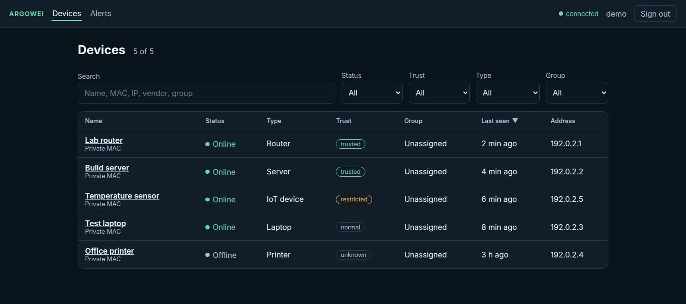

# Argowei

  

<strong>Know what is on your network. Understand what changed.</strong>

Argowei is a self-hosted network inventory for homelabs and private infrastructure. It discovers devices on a local network, keeps their history, and helps you review unfamiliar devices from a web dashboard. The project is in active early development.

| Available today | Planned direction |
| --- | --- |
| ARP discovery, persistent device inventory, hostname lookup | Service and vulnerability analysis |
| Presence history and new-device alerts | DNS and network intelligence |
| Device labels, groups, trust levels, and audit log | Policy enforcement through controlled infrastructure |

Argowei only observes the networks and interfaces you configure. ARP replies and hostnames are not proof of device identity, and a normal LAN host cannot see all traffic between other devices.

The application has four Rust crates: `argowei-core` holds device and name
models, `argowei-collector` sends ARP requests and resolves names,
`argowei-api` persists scans and serves the authenticated HTTP API, and
`argowei-cli` exposes interface discovery and manual scans. PostgreSQL stores
the inventory and scan history; the Angular dashboard presents them.

## Preview

Screenshot of the running dashboard with [synthetic demo data](docs/demo-data.sql).

## Get started

Choose a setup in the [deployment guide](docs/DEPLOYMENT.md). Docker Compose uses host networking for LAN discovery and is intended for Linux. The API applies pending database migrations at startup. After setup, open the dashboard at <http://localhost:4200>; the API runs at <http://localhost:8000/api>. On first launch, the API logs a setup token for the initial admin account.

Discovery is disabled until you configure an interface. The [technical reference](docs/TECHNICAL-REFERENCE.md#scheduled-discovery) shows the settings and required permissions.

## Documentation

- [Deployment](docs/DEPLOYMENT.md) — installation and network setup
- [Threat model](docs/THREAT-MODEL.md) — trust boundaries, controls and deployment limits
- [Technical reference](docs/TECHNICAL-REFERENCE.md) — discovery, authentication, data model, and development checks
- [Presence evaluation](docs/PRESENCE-EVALUATION.md) — synthetic checks, a [trace replay benchmark](docs/PRESENCE-REPLAY.md), and a [lab export protocol](docs/PRESENCE-LAB.md) for independently labeled observations

## Contributing

Read the [contributing guide](https://github.com/argowei/.github/blob/main/CONTRIBUTING.md) or [open an issue](https://github.com/argowei/argowei/issues). The project is licensed under [MIT](LICENSE).

## Development and attribution

Argowei is a collaboration between Deniz Altunkapan and Silas. The commit
history records the work in detail. Deniz introduced the Rust workspace,
devices API, CLI interface listing, ARP discovery and its concurrency bounds,
the device/address separation, and the reproducible presence evaluations.
Silas developed the PostgreSQL-backed service, scheduled discovery,
authentication and audit logging, naming and classification, and much of the
dashboard.
